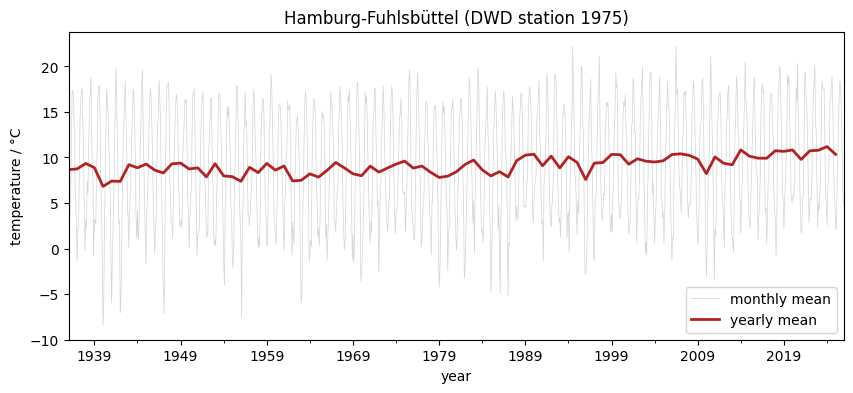
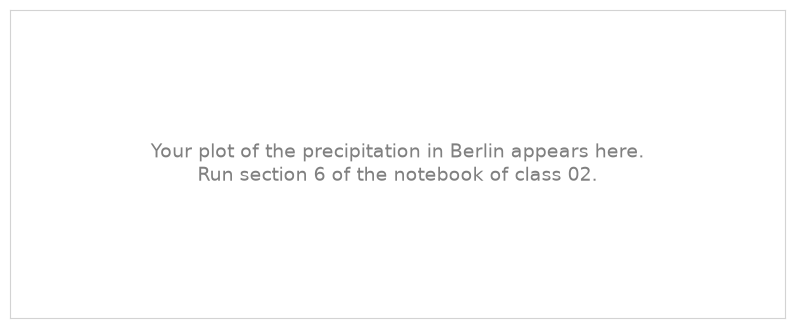

.. Lines that start with ".." and a space, like these, are comments: they do not appear on the page.
   This is your page of class 02: replace the example text with yours and save.
   The notebook of class 02 saves your plots next to this page.

2 - Station Data Exercise
=========================

:Name: Student

Temperature in Hamburg
----------------------

   Monthly and yearly mean temperature at the DWD station Hamburg-Fuhlsbüttel.

Describe the plot in two or three sentences: how warm is Hamburg on average? Which were the warmest and
the coldest years? Do you see a change over time?

Precipitation in Berlin
-----------------------

.. Section 6 of the notebook replaces this picture with your plot.

   Monthly and yearly precipitation at the DWD station Berlin-Tempelhof.

Describe the plot: how much does it rain in Berlin in a year? Which were the wettest and the driest
years? Is the precipitation more regular than the temperature from year to year?

What I learned
--------------

- Write two or three things you learned in this class, one per line.
