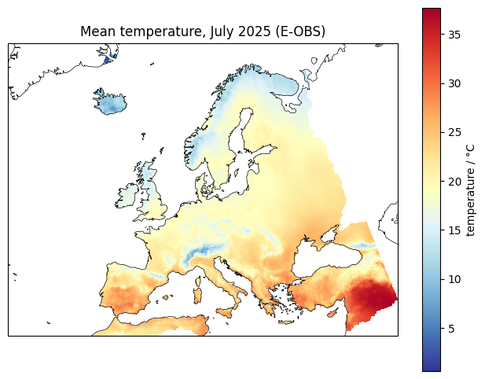
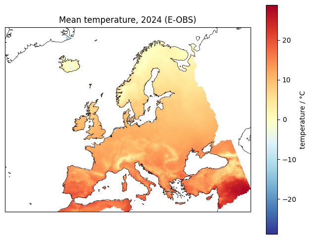
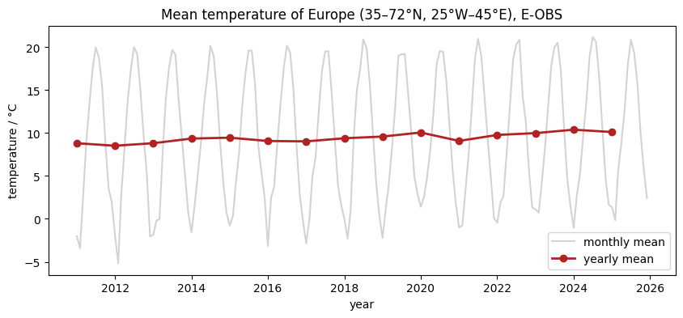
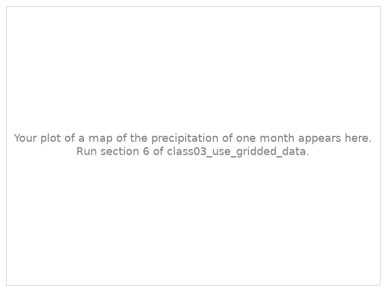
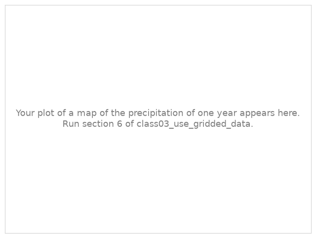
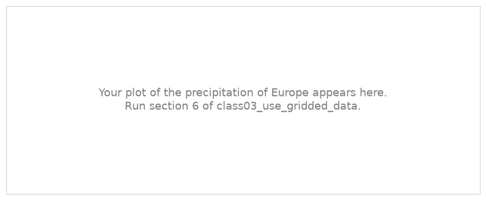

.. Lines that start with ".." and a space, like these, are comments: they do not appear on the page.
   This is your page of class 03: replace the example text with yours and save.
   The notebook class03_use_gridded_data saves your plots next to this page.

Climate data in NetCDF - lon-lat grid
=====================================

:Name: Student

Temperature of Europe
---------------------

   Mean temperature of one month (E-OBS).

   Mean temperature of one year (E-OBS).

   Monthly and yearly mean temperature of Europe, weighted by the area of the cells (E-OBS).

Describe the maps and the time series in a few sentences: where is Europe warmest and coldest, in the month
and in the year? How does the temperature of Europe change from year to year?

Precipitation of Europe
-----------------------

.. Section 6 of the notebook replaces these pictures with your plots.

   Precipitation of one month (E-OBS).

   Precipitation of one year (E-OBS).

   Monthly and yearly precipitation of Europe (E-OBS).

Describe them: where does it rain most and least? Is the precipitation of Europe as regular from year to
year as its temperature?

What I learned
--------------

- Write two or three things you learned in this class, one per line.

.. E-OBS asks everybody who uses it to acknowledge it: keep this line.

*Data: E-OBS* :cite:`Cornes_2018`.
