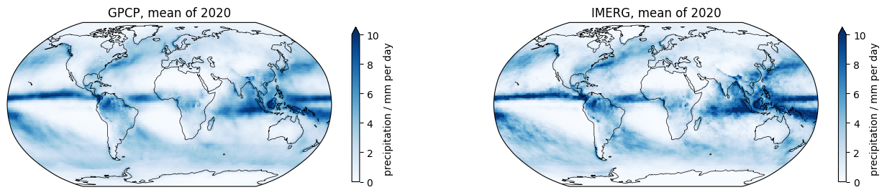
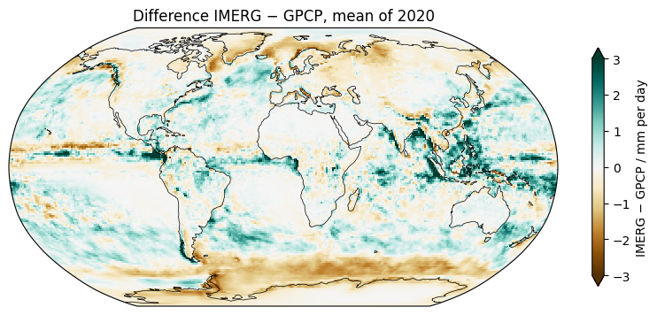
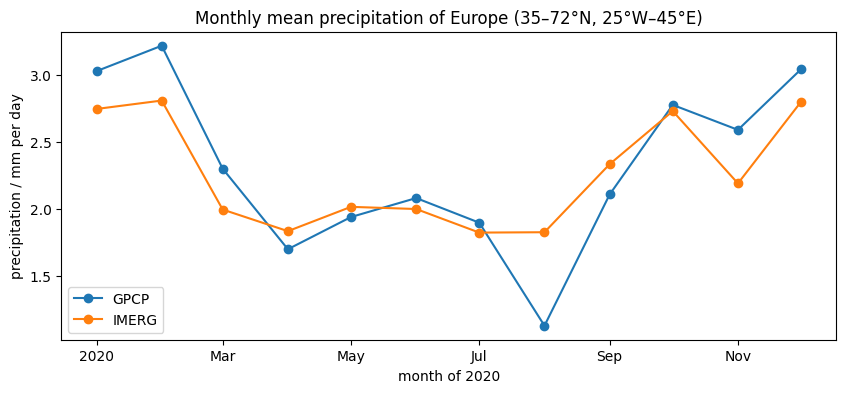
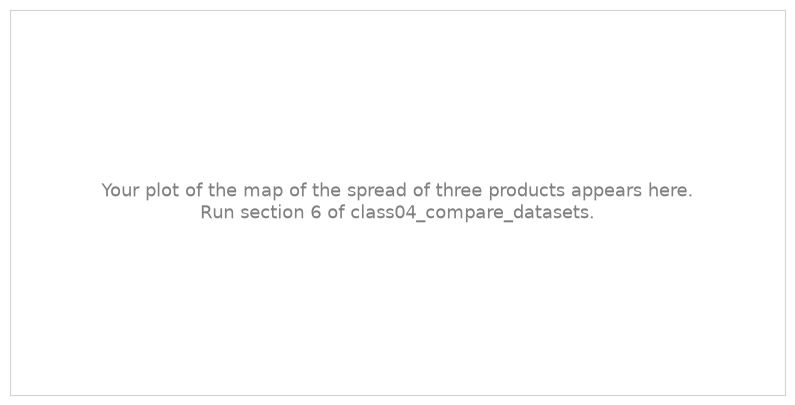
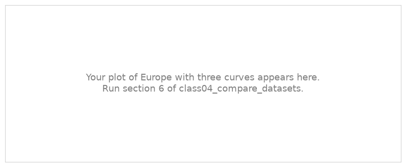

.. Lines that start with ".." and a space, like these, are comments: they do not appear on the page.
   This is your page of class 04: replace the example text with yours and save.
   The notebook class04_compare_datasets saves your plots next to this page.

Comparing datasets - Uncertanity
================================

:Name: Student

Two estimates of the precipitation of 2020
------------------------------------------

   Mean precipitation of 2020 from GPCP (left) and IMERG (right).

   Difference IMERG − GPCP, mean of 2020.

Describe the maps in a few sentences: where does it rain most? Where do the two products agree, and where
do they differ most?

Europe
------

   Monthly mean precipitation of Europe from GPCP and IMERG, 2020.

Describe the two curves: in which months do they differ most?

A third product
---------------

.. Section 6 of the notebook replaces these pictures with your plots.

   Spread (standard deviation) of three products, mean of 2020.

   Monthly mean precipitation of Europe from three products, 2020.

Which product did you add? Where is the spread largest? What does it tell you about how well we know the
precipitation?

What I learned
--------------

- Write two or three things you learned in this class, one per line.

*Data: FROGS* :cite:`Roca_2019`.
