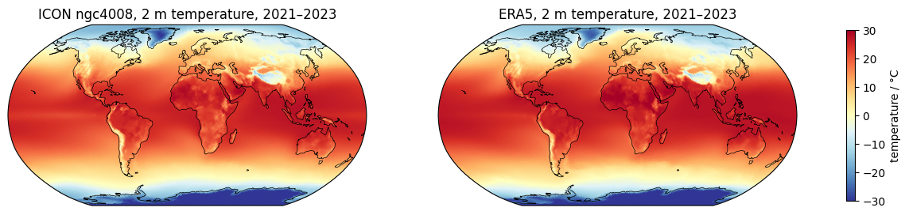
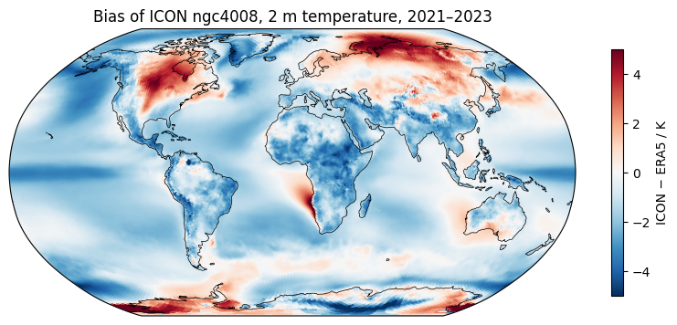
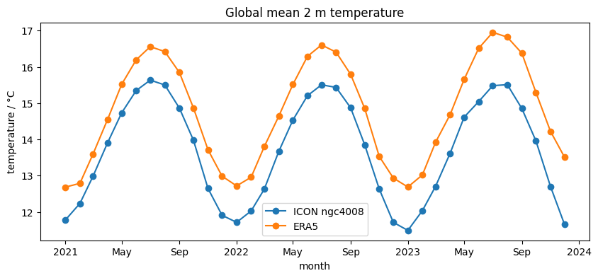
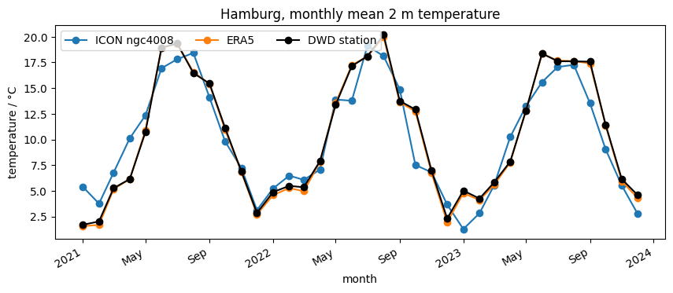
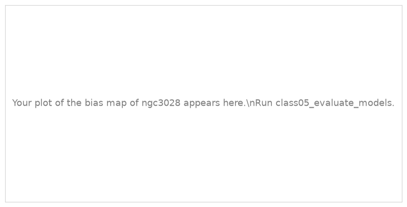
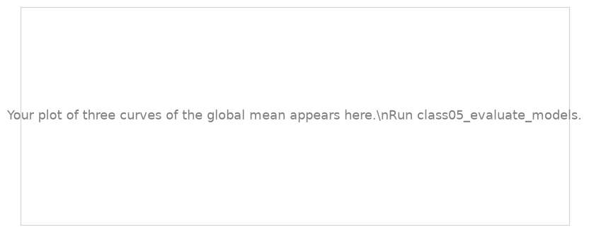

.. Lines that start with ".." and a space, like these, are comments: they do not appear on the page.
   This is your page of class 05: replace the example text with yours and save.
   The notebook class05_evaluate_models saves your plots next to this page.

Example Student · Hamburg
=========================

:Name: Example Student

The model and ERA5
------------------

   Mean 2 m temperature of 2021–2023 of the ICON simulation ngc4008 (left) and ERA5 (right), HEALPix zoom 6.

   Bias of ICON ngc4008: ICON minus ERA5, mean of 2021–2023.

Describe the bias in a few sentences: where is the model too warm, where too cold, and by how much?

Time series
-----------

   Global mean 2 m temperature of ICON ngc4008 and ERA5, monthly, 2021–2023.

   Monthly mean 2 m temperature in Hamburg: ICON ngc4008, ERA5 and the DWD station Hamburg-Fuhlsbüttel.

Describe them: is the global bias the same every month? Why can the model be several degrees off in a single month in Hamburg, while ERA5 and the station agree?

A second simulation
-------------------

.. Section 6 of the notebook replaces these pictures with your plots.

   Bias of ICON ngc3028, mean of 2021–2023.

   Global mean 2 m temperature of ngc3028, ngc4008 and ERA5.

Which simulation is closer to ERA5, globally and in the north?

What I learned
--------------

- Write two or three things you learned in this class, one per line.
