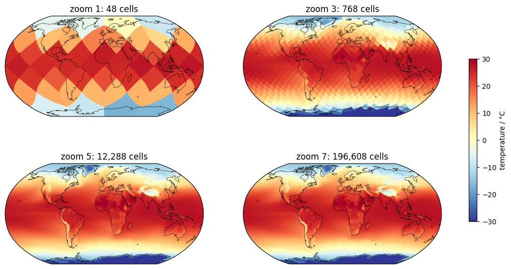
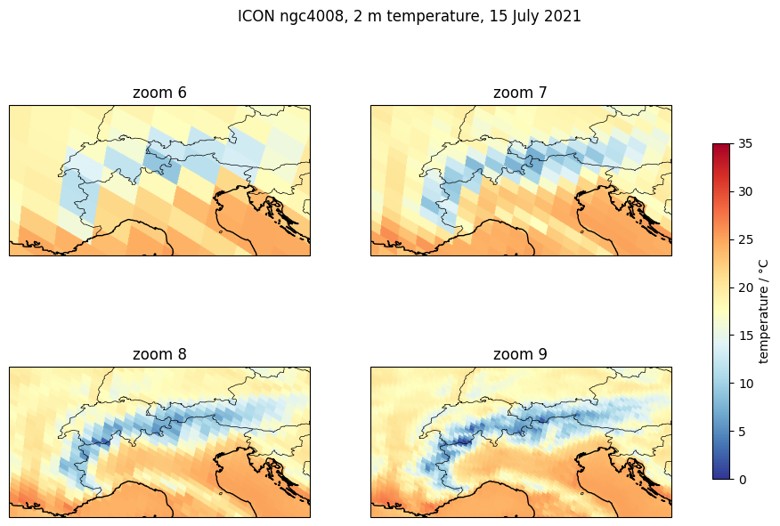
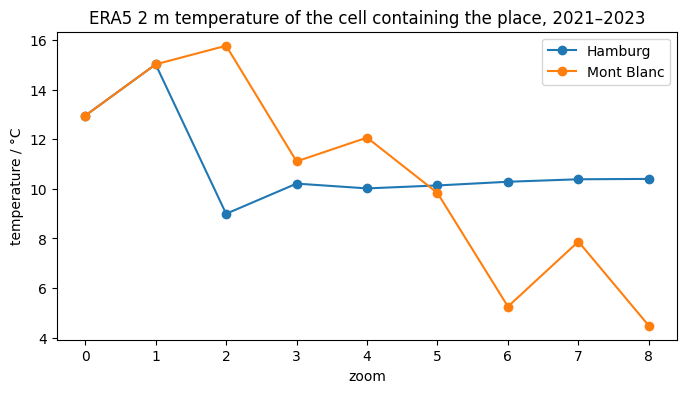
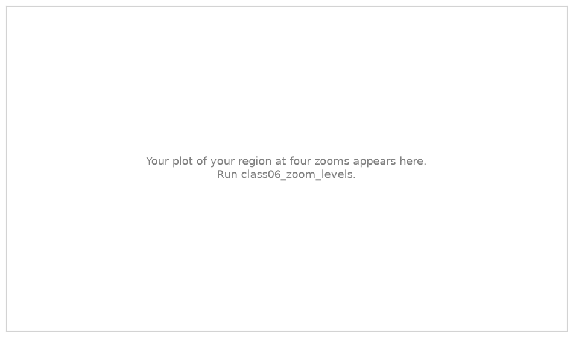
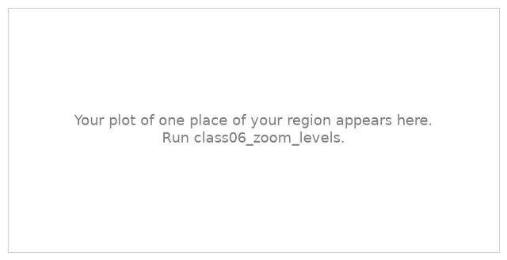

.. Lines that start with ".." and a space, like these, are comments: they do not appear on the page.
   This is your page of class 06: replace the example text with yours and save.
   The notebook class06_zoom_levels saves your plots next to this page.

Example Student · Hamburg
=========================

:Name: Example Student

Maps at different zoom levels
-----------------------------

   ERA5 2 m temperature, mean of 2021–2023, at zoom 1, 3, 5 and 7.

   ICON ngc4008 2 m temperature of 15 July 2021 in the Alps, at zoom 6, 7, 8 and 9.

Describe the maps: from which zoom does the globe look right? What do you see in the Alps at zoom 9 that you
do not see at zoom 6?

One place
---------

   ERA5 2 m temperature of the cell containing Hamburg and the Mont Blanc, at zoom 0 to 8.

Why does the global mean not change with the zoom, but the value of one place does?

My region
---------

.. The exercise of the notebook replaces these pictures with your plots.

   My region at four zoom levels.

   One place of my region at zoom 0 to 8.

Which zoom do you need to see what interests you in your region?

What I learned
--------------

- Write two or three things you learned in this class, one per line.
