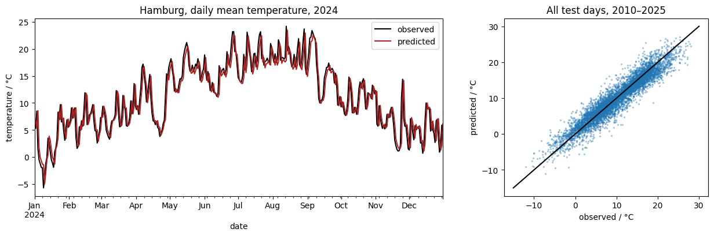
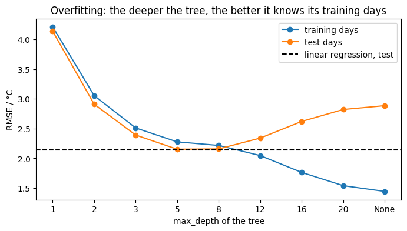
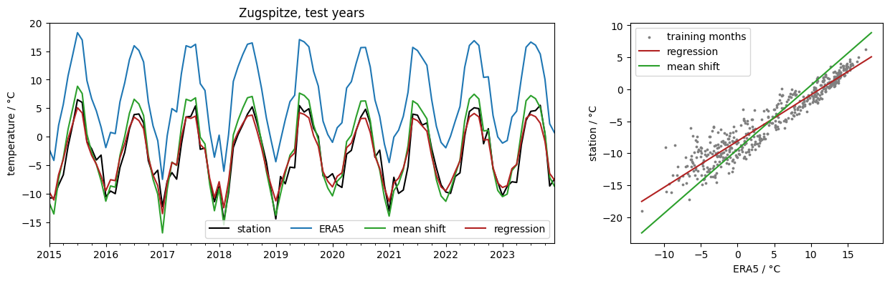
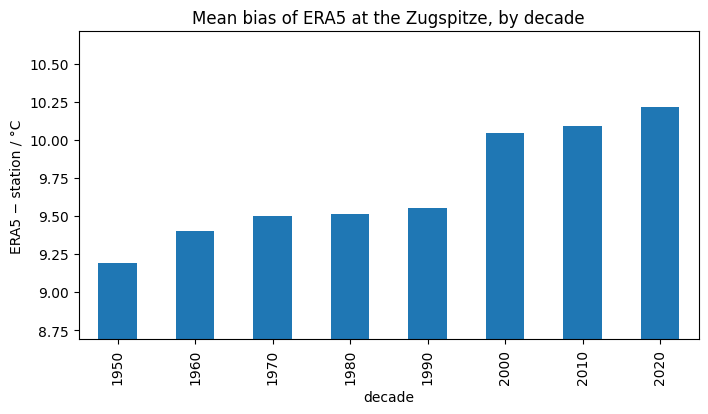

.. Lines that start with ".." and a space, like these, are comments: they do not appear on the page.
   This is your page of class 07: replace the example text with yours and save.
   The notebooks of class 07 save your plots next to this page.

Machine learning for climate data
=================================

:Name: Student

A first model
-------------

   Daily mean temperature of Hamburg in the test years: observed and predicted by a linear regression from the
   two days before.

   Error of decision trees of increasing depth on the training and on the test days.

How good is the model compared with persistence (tomorrow = today)? What does the second plot show?

Bias correction
---------------

   Zugspitze: station, ERA5 and two corrections in the test years; the corrections learned on 1950–1990.

   Mean bias of ERA5 at the Zugspitze, by decade.

Why is ERA5 so warm on the Zugspitze? Which correction works better, and is the bias the same in every decade?

What I learned
--------------

- Write two or three things you learned in this class, one per line.
