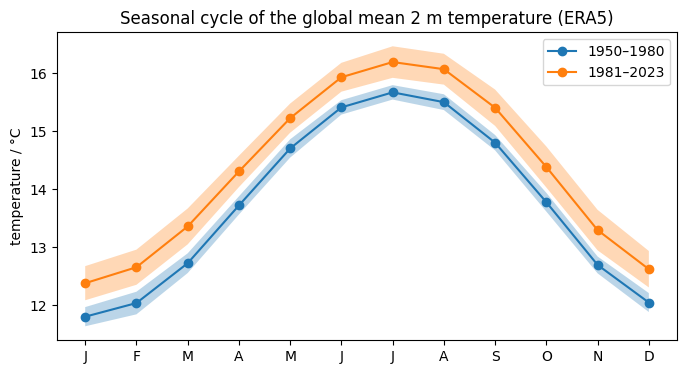
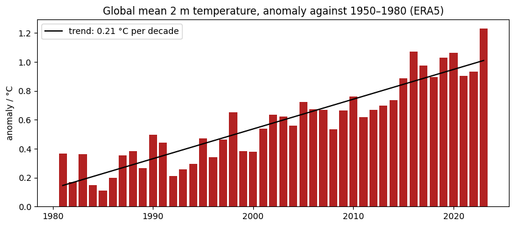
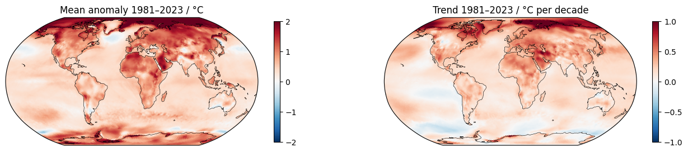
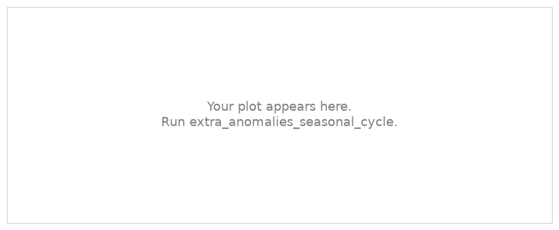

.. Lines that start with ".." and a space, like these, are comments: they do not appear on the page.
   This is your page of the extra *Anomalies and the seasonal cycle*: replace the example text with yours and save.
   The notebook extra_anomalies_seasonal_cycle saves your plots next to this page.

Example Student · Hamburg
=========================

:Name: Example Student

Anomalies and the seasonal cycle
--------------------------------

   Seasonal cycle of the global mean 2 m temperature, 1950–1980 and 1981–2023 (ERA5).

   Yearly anomalies of the global mean 2 m temperature against 1950–1980, and their trend.

   Mean anomaly of 1981–2023 and its trend per decade.

How much has the globe warmed, and where most?

Exercise
--------

.. The exercise of the notebook replaces this picture with your plot.

   Seasonal cycle and anomalies of one place.

Describe what you found in a few sentences.

What I learned
--------------

- Write two or three things you learned, one per line.
