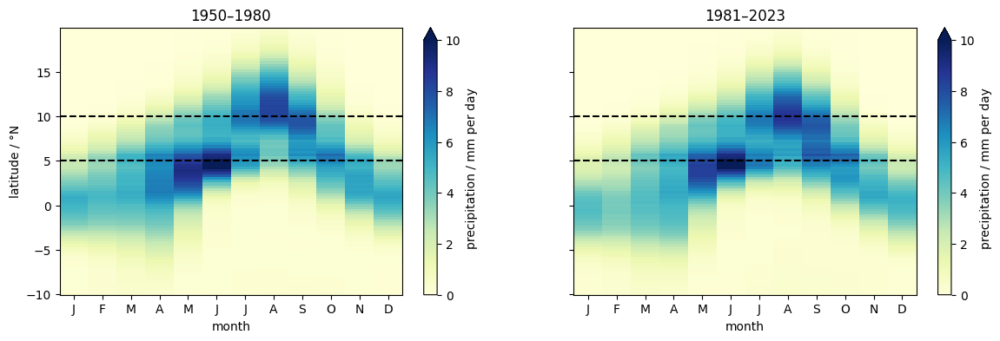
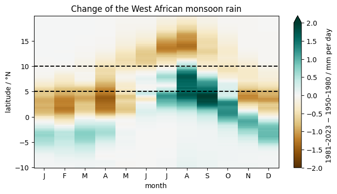
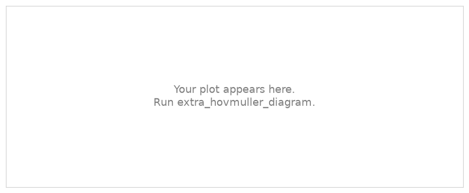

.. Lines that start with ".." and a space, like these, are comments: they do not appear on the page.
   This is your page of the extra *A Hovmöller diagram of the West African monsoon*: replace the example text with yours and save.
   The notebook extra_hovmuller_diagram saves your plots next to this page.

Example Student · Hamburg
=========================

:Name: Example Student

A Hovmöller diagram of the West African monsoon
-----------------------------------------------

   Monthly precipitation between 10°W and 10°E by latitude, 1950–1980 and 1981–2023 (ERA5).

   Difference 1981–2023 minus 1950–1980.

When does the rain of the monsoon reach the Sahel? Has it changed?

Exercise
--------

.. The exercise of the notebook replaces this picture with your plot.

   A Hovmöller diagram of the Indian monsoon.

Describe what you found in a few sentences.

What I learned
--------------

- Write two or three things you learned, one per line.
