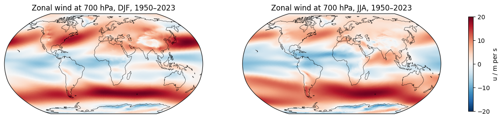
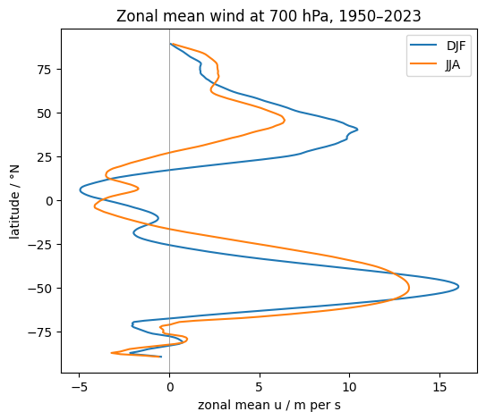
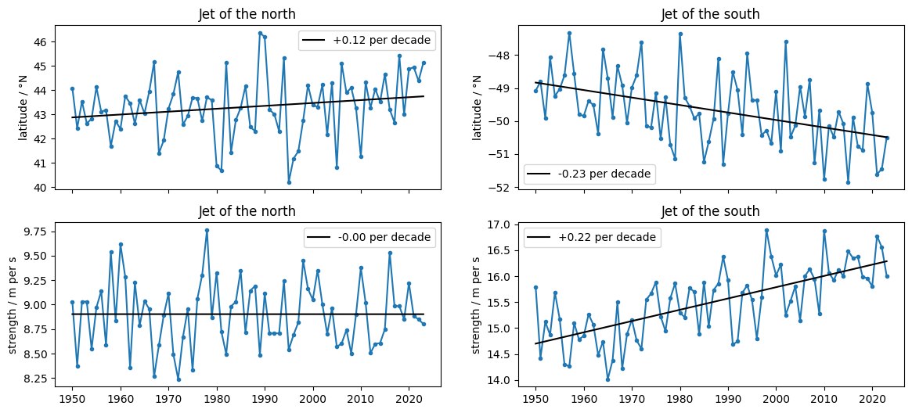
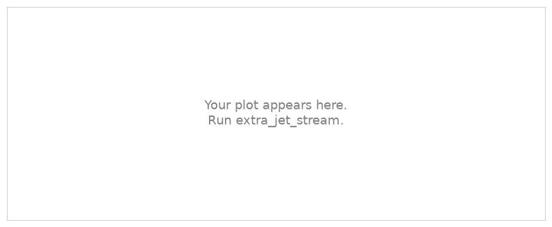

.. Lines that start with ".." and a space, like these, are comments: they do not appear on the page.
   This is your page of the extra *The jet stream*: replace the example text with yours and save.
   The notebook extra_jet_stream saves your plots next to this page.

Example Student · Hamburg
=========================

:Name: Example Student

The jet stream
--------------

   Zonal wind at 700 hPa in DJF and JJA, 1950–2023 (ERA5).

   Zonal mean wind at 700 hPa in DJF and JJA.

   Latitude and strength of the eddy-driven jet in each hemisphere, yearly, with trends.

Where is the jet in winter and in summer? Has it moved or changed its strength since 1950?

Exercise
--------

.. The exercise of the notebook replaces this picture with your plot.

   The jet at 250 hPa.

Describe what you found in a few sentences.

What I learned
--------------

- Write two or three things you learned, one per line.
