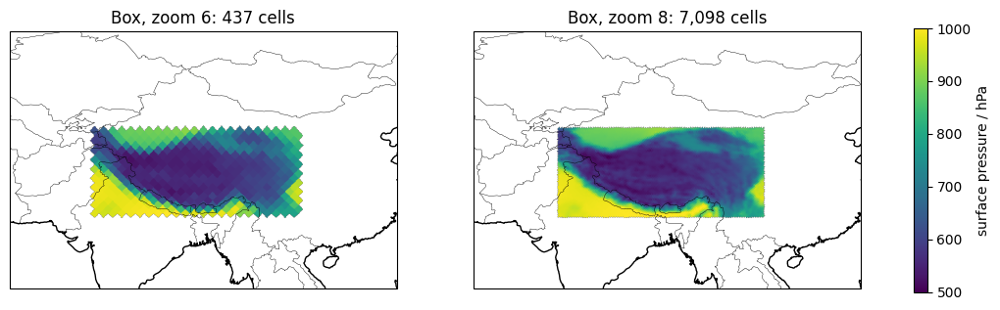
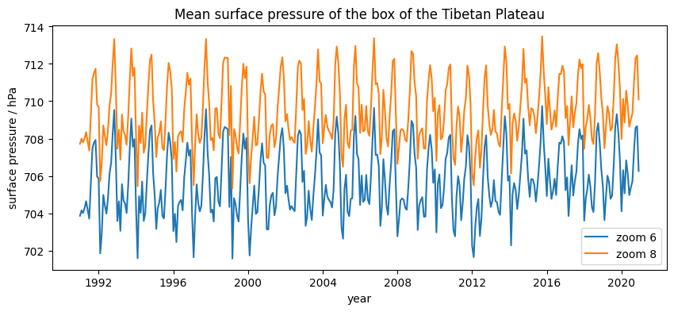
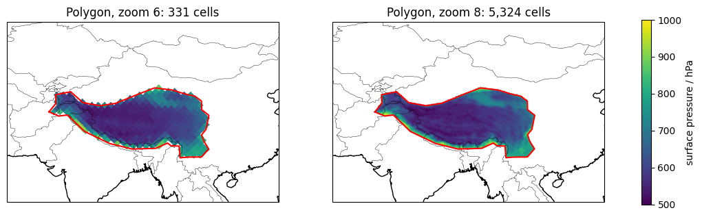
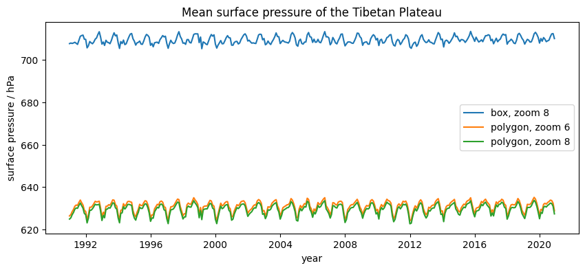
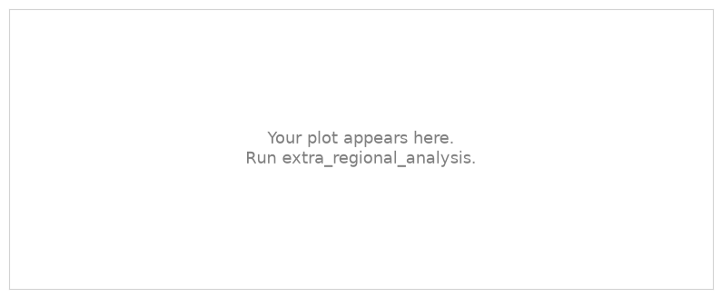

.. Lines that start with ".." and a space, like these, are comments: they do not appear on the page.
   This is your page of the extra *Regional analysis*: replace the example text with yours and save.
   The notebook extra_regional_analysis saves your plots next to this page.

Example Student · Hamburg
=========================

:Name: Example Student

Regional analysis
-----------------

   The cells of a box around the Tibetan Plateau at zoom 6 and 8, mean surface pressure 1991–2020.

   Mean surface pressure of the box at zoom 6 and 8.

   The cells of a polygon of the Tibetan Plateau at zoom 6 and 8.

   Mean surface pressure of the box and of the polygon.

Which matters more for the regional mean of the plateau: the shape of the region or the zoom?

Exercise
--------

.. The exercise of the notebook replaces this picture with your plot.

   My region at zoom 6 and 8.

Describe what you found in a few sentences.

What I learned
--------------

- Write two or three things you learned, one per line.
