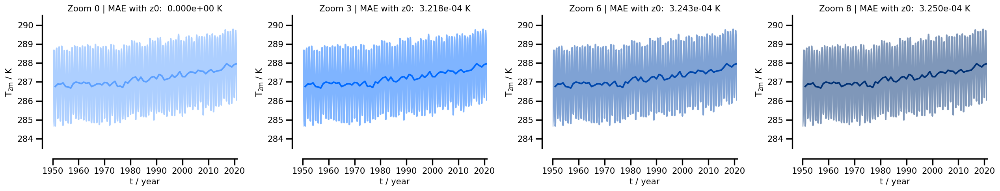
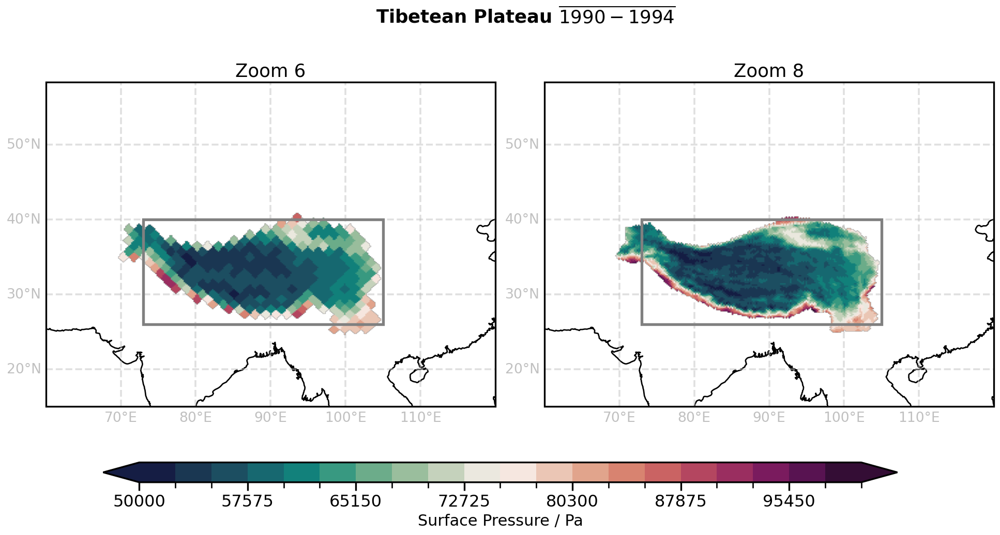

.. _lesson_01:

01 · Basics of xarray for climate data
================================================================================

Notebook: `examples/01_basics_xarray_climate.ipynb <https://github.com/angelpeinadobravo/tuhh_python_for_climate_2026/blob/main/examples/01_basics_xarray_climate.ipynb>`_
· Slides: `01 · Basics of xarray <../../slides/deck.html?md=01_basics_xarray_climate.md>`_

What you learn
--------------

- Compute global means on HEALPix: all cells have the same area, so a plain ``.mean("cell")`` is area-weighted.
- Measure how much the zoom level changes a result with the mean absolute error (MAE).
- Pick the cell closest to a location with ``healpix.ang2pix`` (point-wise analysis).
- Select a region by the indices of the cells inside it (limited-area analysis), first with a box and then
  with a ``shapely`` polygon and ``geopandas``.

Global mean temperature at different zoom levels
------------------------------------------------

:numref:`lesson01_global_mean` shows that the global mean 2 m temperature barely depends on the zoom level:
the MAE against zoom 0 is below :math:`10^{-3}` K.

.. _lesson01_global_mean:

   Monthly (light) and yearly (dark) global mean 2 m temperature of ERA5 at zoom 0, 3, 6 and 8, 1950–2020.

Limited-area analysis
---------------------

A box is a poor shape for the Tibetan Plateau. :numref:`lesson01_poly` selects the cells inside a polygon instead;
zoom 8 resolves the edge of the plateau far better than zoom 6.

.. _lesson01_poly:

   1990–1994 mean surface pressure of ERA5 inside a Tibetan Plateau polygon at zoom 6 (left) and 8 (right).
   The grey rectangle is the box used before.

Exercises
---------

#. **Limited-area time series.** Repeat the point-wise time-series analysis for the regions, for surface
   pressure and precipitation. How much error does a coarser zoom introduce?
#. **Better regions.** Describe the Tibetan Plateau (bonus: Costa Rica) with a polygon.
#. **Extra.** Compare box and polygon: how much error comes from the shape, and how much from the zoom?

Lessons learned
---------------

Add your file to ``docs/source/lessons/01_basics_xarray_climate/learned/`` (:ref:`how to <contribsci>`).

.. toctree::
   :glob:
   :maxdepth: 1

   learned/*
