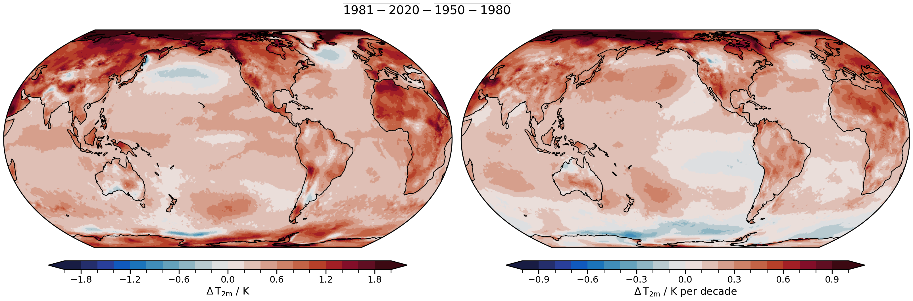
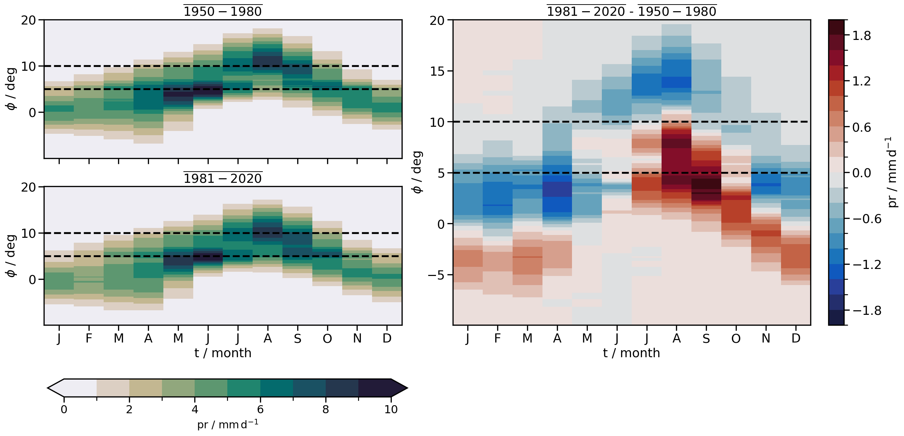
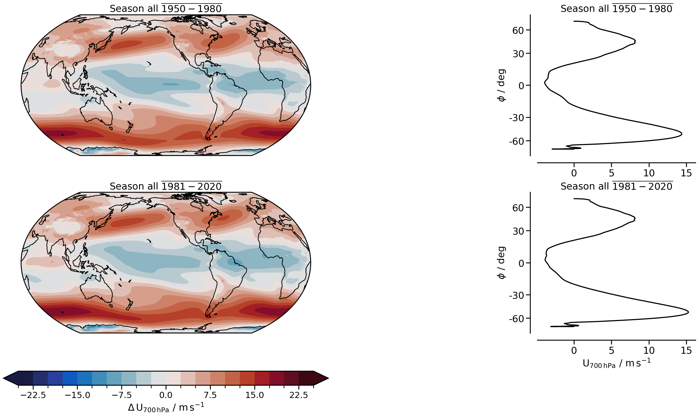

.. _lesson_02:

02 · Climate analysis with xarray
================================================================================

Notebook: `examples/02_more_xarray_climate.ipynb <https://github.com/angelpeinadobravo/tuhh_python_for_climate_2026/blob/main/examples/02_more_xarray_climate.ipynb>`_
· Slides: `02 · Climate analysis <../../slides/deck.html?md=02_more_xarray_climate.md>`_

What you learn
--------------

- Compute monthly anomalies of a recent period (1981–2020) against a reference period (1950–1980)
  with ``groupby("time.month")``.
- Fit linear trends per cell with ``xarray.apply_ufunc`` and ``numpy.polyfit``.
- Draw a Hovmöller diagram (latitude vs month) of the West African monsoon rainfall.
- Locate the eddy-driven jet in the 700 hPa zonal wind and follow its latitude and strength.
- Correlate yearly anomalies with ``pandas.DataFrame.corr``.

Warming and its trend
---------------------

.. _lesson02_warming:

   ERA5 2 m temperature: mean anomaly of 1981–2020 against 1950–1980 (left) and trend of the yearly
   anomalies in K per decade (right).

Monsoon rainfall in the Sahel
-----------------------------

.. _lesson02_hovmuller:

   Monthly precipitation averaged over 10° W–10° E for 1950–1980 and 1981–2020 (left) and their
   difference (right). Dashed lines: 5° N (Guinean coast) and 10° N (monsoon onset in the Sahel).

The eddy-driven jet
-------------------

.. _lesson02_jet:

   700 hPa zonal wind of ERA5, all seasons, for 1950–1980 (top) and 1981–2020 (bottom): maps (left) and
   zonal means (right). The eddy-driven jets are the maxima near 45° N and 50° S.

Lessons learned
---------------

Add your file to ``docs/source/lessons/02_more_xarray_climate/learned/`` (:ref:`how to <contribsci>`).

.. toctree::
   :glob:
   :maxdepth: 1

   learned/*
