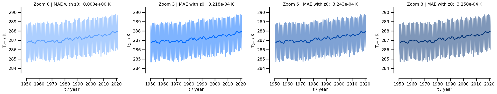
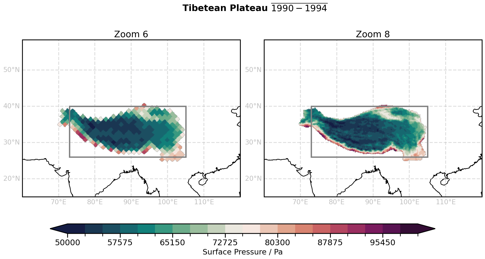

# 01 · Basics of xarray for climate data

Python for Climate Science · TUHH

<small>MPI-M · notebook `examples/01_basics_xarray_climate.ipynb`</small>

---

## Today

1. **Global means** and how much the zoom level matters
2. **Points**: the cell closest to a location
3. **Regions**: boxes and polygons

Data: ERA5 1950–2020, `2t` (K), `tp` (m → mm/d) and `sp` (Pa), zoom 0, 3, 6 and 8.

---

## Global means on HEALPix

```python
ds_era5_zoom_8["2t"].mean("cell").compute()
```

All cells have the same area, so the plain mean is already **area-weighted**.

<small>On a lon-lat grid you need weights: `ds.weighted(np.cos(np.deg2rad(ds.lat))).mean(("lat", "lon"))`</small>

---

## Does the zoom level matter?



Mean absolute error against zoom 0: below 0.001 K.

---

## Points

```python
import healpix as hp

f_get_point_in_ds = lambda ds, lon, lat: ds.isel(
    cell=hp.ang2pix(hp.npix2nside(ds.cell.size), lon, lat, nest=True, lonlat=True)
)
f_get_point_in_ds(ds_era5_zoom_8, -156.33, 20.8)   # Maui
```

`ang2pix` returns the **closest** cell: at zoom 3 it can be hundreds of km away.

---

## Regions as cell indices

```python
from utils import get_lon_lat, f_intersection

lon, lat = get_lon_lat(ds_era5_zoom_6)
idx = f_intersection(np.where((lon > 73) & (lon < 105))[0],
                     np.where((lat > 26) & (lat < 40))[0])
ds_region = ds_era5_zoom_6.sel(cell=idx)
```

Indices keep the grid and are cheap to reuse.

---

## Regions are not boxes



```python
from shapely.geometry import Polygon
import geopandas as gpd

gdf = gpd.GeoDataFrame(geometry=gpd.points_from_xy(lon, lat))
idx = gdf[gdf.geometry.within(Polygon(coords))].index.values
```

---

## Exercises

1. **Limited-area time series** of surface pressure and precipitation: how much error does a coarser zoom add?
2. **Better regions**: a polygon for the Tibetan Plateau (bonus: Costa Rica)
3. **Extra**: box vs polygon, and coarse vs fine zoom

<small>Then add your lessons learned to the webpage.</small>

---

# Questions?
