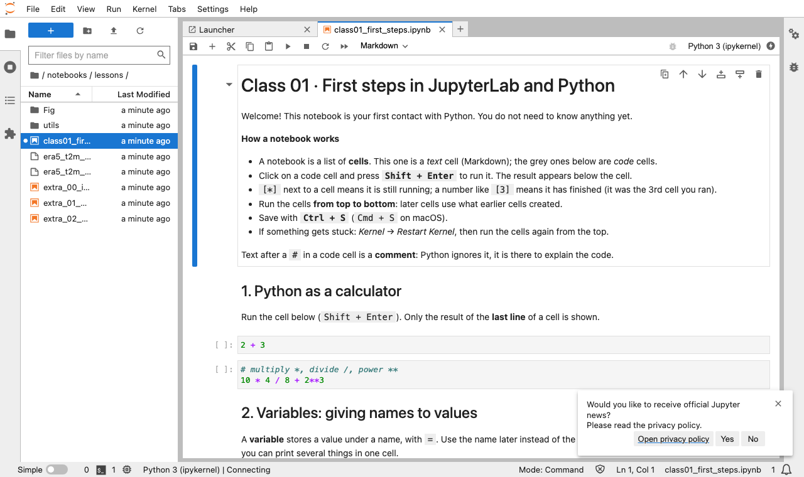
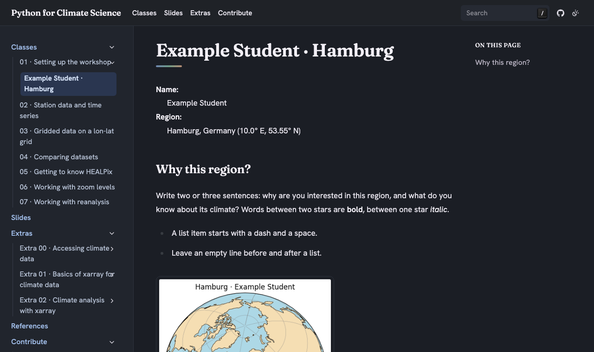

# 01 · Setting up the workshop

Python for Climate Science · TUHH

<small>MPI-M · class page: *Classes → 01* · notebook `examples/class01_first_steps.ipynb`</small>

---

## Today

1. Install **Docker** and start the workshop
2. Find your way in **JupyterLab**
3. Your first **notebook** and your first lines of **Python**
4. Your own **page** on the workshop webpage: your name and your region of the world

Note: Everything on these slides is also on the class page, step by step, to revisit after the class.

---

## The workshop on your laptop

| What | Where |
|---|---|
| **Docker** runs a small computer with Python and all packages | the *container* |
| **JupyterLab**: notebooks, terminal, editor | http://localhost:8888 |
| **Webpage**: classes, slides, your pages | http://localhost:8000 |
| **Your work**, saved on your laptop | `course/` and `my_notebooks/` |

Same environment for everybody, nothing else to install, nothing lost when you stop.

---

## 1 · Install Docker (once)

| System | Install |
|---|---|
| Windows | Docker Desktop (accept WSL 2) |
| macOS | Docker Desktop |
| Linux | Docker Engine + Compose plugin |

Check in a terminal:

```bash
docker compose version
```

Note: Links to the installers are on the class page. On Windows the terminal is PowerShell; on macOS the app Terminal.

---

## 2 · Start the workshop

In the unzipped workshop folder:

```bash
cp .env.example .env          # Windows: Copy-Item .env.example .env
# open .env and choose your password
docker compose up --build     # first time: 10–15 minutes
```

Wait for:

```text
JupyterLab: http://localhost:8888   Webpage and slides: http://localhost:8000
```

Next time: `docker compose up` · stop: `Ctrl + C`

---

## 3 · JupyterLab



<small>Left: files · Tabs: notebooks, terminal, editor · The *Jupyter news* pop-up: click **No**.</small>

---

## A notebook in 30 seconds

- A notebook is a list of **cells**: text (Markdown) or **code**
- **`Shift + Enter`** runs a cell; the result appears below it
- `[*]` = running · `[3]` = done, 3rd cell you ran
- Run **from top to bottom**
- Save: `Ctrl + S` · stuck? *Kernel → Restart Kernel*

---

## 4 · Your first notebook

Open a terminal in JupyterLab (*Launcher → Terminal*) and copy the course notebooks into your folder:

```bash
cp -r /app/examples /app/notebooks/lessons
```

Then open `notebooks/lessons/class01_first_steps.ipynb` and run it, cell by cell.

Note: Working in a copy keeps the course files clean, so new lessons always reach the students.

---

## Python in a few lines

```python
temperature = 15.3                       # a variable
temperatures = [12.1, 13.4, 15.0]        # a list, counted from 0
print(f"First day: {temperatures[0]} °C")

def celsius_to_kelvin(celsius):          # a function
    return celsius + 273.15

import numpy as np                       # a package
print(np.mean(temperatures))
```

All of it, with explanations, is in the notebook.

---

## 5 · Your page on the webpage

1. Copy the example page, with **your** names:
   ```bash
   cd /app/docs/source/classes/01_setup/students
   cp 00_example.rst <lastname>_<firstname>.rst
   ```
2. Make your picture: section 7 of the notebook, or **upload** one
3. Edit your `.rst` file in JupyterLab and save
4. Check it on http://localhost:8000 → *Classes → 01*
5. Print → **Save as PDF** → send it to the tutor

---

## Writing a page

```rst
Jane Doe · Andes
================

:Name: Jane Doe
:Region: Andes, Peru

Why this region?
----------------

Words between two stars are **bold**.

.. figure:: doe_jane.png
   :width: 60%

   The caption of the picture.
```

<small>The `=` line must be as long as the title · empty lines matter.</small>

---

## What it looks like



---

## 6 · Stop and start again

- Stop: `Ctrl + C`, or `docker compose down`
- Start: `docker compose up`
- Your work is on your laptop:
  - `course/` · the course and **your page**
  - `my_notebooks/` · **your notebooks**

Every start downloads the new lessons; your own files are never overwritten.

---

## Something does not work?

| Problem | What to do |
|---|---|
| `Cannot connect to the Docker daemon` | Start Docker Desktop |
| `port is already allocated` | Another Jupyter is running: stop it |
| JupyterLab asks for a token | Your password from `.env` |
| Your page does not appear | Read the error in the terminal of `docker compose up` |

<small>More in the `README.md` of the workshop folder.</small>

---

## For next class

- Finish your page and send the PDF to the tutor
- Next: **02 · Station data and time series**

---

# Questions?
