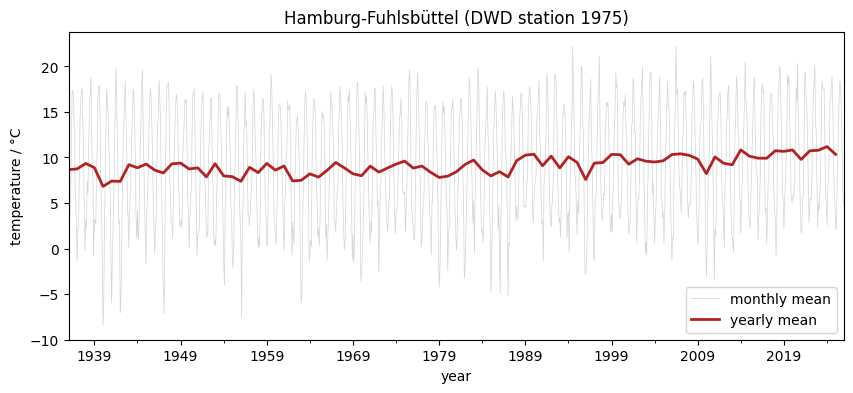

# 02 · Station data and time series

Python for Climate Science · TUHH

<small>MPI-M · class page: *Classes → 02* · notebook `notebooks/lessons/class02_station_data.ipynb`</small>

---

## Today

1. Where to find **station data**: the German Weather Service (DWD)
2. Read a table of measurements with **pandas**
3. **Dates**, missing values, monthly and yearly values
4. Plot a **time series** and put it on your page

---

## Weather stations

- A station measures at **one place**, every day: temperature, precipitation, wind, sunshine ...
- Long records: Hamburg-Fuhlsbüttel since **1936**
- The DWD publishes them for free: [opendata.dwd.de](https://opendata.dwd.de/climate_environment/CDC/observations_germany/climate/daily/kl/)

| Number | Station | In this class |
|---:|---|---|
| 1975 | Hamburg-Fuhlsbüttel | example: temperature |
| 433 | Berlin-Tempelhof | exercise: precipitation |

Note: The list of all stations, with their numbers and periods, is linked on the class page.

---

## Getting the file

```python
from utils import download_dwd_daily

hamburg_file = download_dwd_daily(1975)   # once, into notebooks/lessons/data/
```

A **zip** file: the measurements (`produkt_klima_tag_...txt`) and descriptions of the station (*Metadaten*).

---

## What the data looks like

```text
STATIONS_ID;MESS_DATUM;QN_3;  FX;  FM;QN_4; RSK;RSKF; SDK;SHK_TAG;  NM; ... TMK; ...
       1975;19360101;-999;-999;-999;    5;   0.1;   1;-999;   0;   7.7; ...  7.3; ...
```

| Column | Meaning | Unit |
|---|---|---|
| `MESS_DATUM` | date, `yyyymmdd` | |
| `TMK` | daily mean temperature | °C |
| `TXK`, `TNK` | daily max, min temperature | °C |
| `RSK` | daily precipitation | mm |

`-999` = no measurement

---

## Reading it with pandas

```python
import pandas as pd

hamburg = pd.read_csv(zip_file.open(data_name), sep=";",
                      skipinitialspace=True, na_values=[-999])
hamburg.head()
```

- `sep=";"`: the values are separated by `;`
- `skipinitialspace=True`: ignore the spaces before them
- `na_values=[-999]`: `-999` becomes `NaN`, *no value*

A **DataFrame**: a table with named columns. `hamburg["TMK"]` is one column.

---

## Dates

```python
# 19360101 as text, then as a date: year %Y, month %m, day %d
dates = hamburg["MESS_DATUM"].astype(str)
hamburg["date"] = pd.to_datetime(dates, format="%Y%m%d")
hamburg = hamburg.set_index("date")

hamburg.loc["2025", "TMK"]      # one year
hamburg["TMK"].isna().sum()     # days without measurement
```

With dates as row labels (the **index**), pandas understands time.

---

## Monthly and yearly values

```python
monthly = hamburg["TMK"].resample("MS").mean()   # MS: month start
yearly  = hamburg["TMK"].resample("YS").mean()   # YS: year start
```

- Temperature: **mean** of the days
- Precipitation adds up: **sum** of the days, `.resample("YS").sum()`

---

## The time series



<small>Hamburg-Fuhlsbüttel, monthly (gray) and yearly (red) mean temperature.</small>

Note: Ask the students what they see before showing the warmest and coldest years with idxmax and idxmin.

---

## Exercise: precipitation in Berlin

Station **433**, Berlin-Tempelhof, column **`RSK`**:

1. Download and read the data, dates as index
2. How many days have no measurement?
3. Monthly and yearly **sums**
4. Plot both, save as `/app/pages/02_station_data/berlin_precipitation.png`
5. The wettest and the driest year?

---

## Your page

1. Open `pages/02_station_data/my_page.rst` in JupyterLab
2. The notebook already put your two plots next to it
3. Write your name and describe each plot in two or three sentences
4. Check it on http://localhost:8000 → *Classes → 02*
5. Print → **Save as PDF** → send it to the tutor

---

## For next class

- Finish the exercise and your page
- Next: **03 · Gridded data on a lon-lat grid** (maps of Europe with E-OBS)

---

# Questions?
