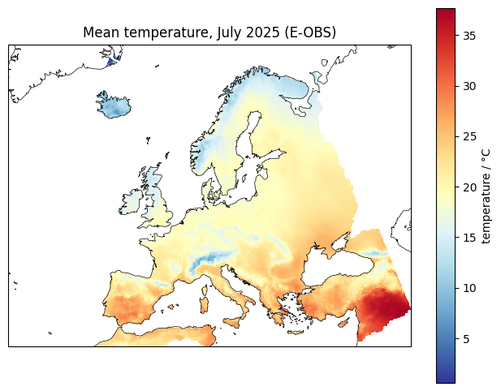
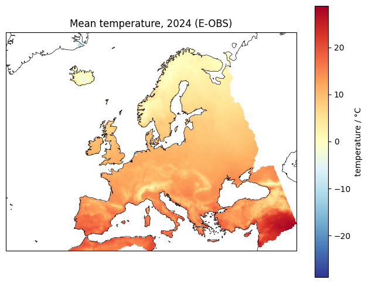
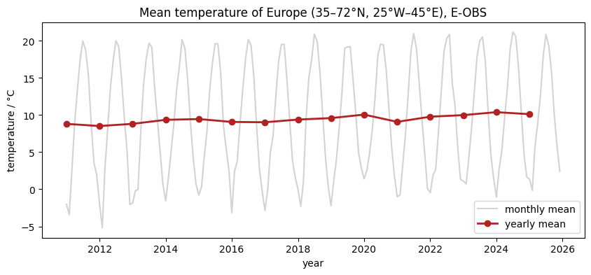

# 03 · Gridded data on a lon-lat grid

Python for Climate Science · TUHH

<small>MPI-M · class page: *Classes → 03* · notebooks `class03_get_gridded_data` and `class03_use_gridded_data`</small>

---

## Today

1. From one station to a **map**: gridded data and **E-OBS**
2. Download a large file, and what is inside a **netCDF** file
3. **Select** days, months, years and places with `xarray`
4. **Maps** of a month and of a year
5. The temperature of **Europe**: why it needs **weights**

---

## A lon-lat grid

```text
latitude
  75°N ┌──┬──┬──┬──┐
       ├──┼──┼──┼──┤   one cell: 0.25° × 0.25°
       ├──┼──┼──┼──┤   one value per day
  25°N └──┴──┴──┴──┘
      40°W        75°E  longitude
```

**E-OBS**: thousands of European weather stations (ECA&D), spread onto a grid · land only

Note: Compare with class 02: a station is one point; a grid gives a value everywhere, also between the stations.

---

## Part 1 · Where is the data?

[surfobs.climate.copernicus.eu/…/access_eobs_chunks.php](https://surfobs.climate.copernicus.eu/dataaccess/access_eobs_chunks.php)

```text
tg_ens_mean_0.25deg_reg_2011-2025_v33.0e.nc
│  │        │           │         └ version
│  │        │           └ period
│  │        └ cells of 0.25°
│  └ mean of an ensemble
└ tg: daily mean temperature (rr: precipitation)
```

0.25°: ~165 MB · 0.1°: ~900 MB → we use **0.25°**

---

## Part 1 · Download

```python
from utils import download_eobs

tg_file = download_eobs("tg")    # temperature
rr_file = download_eobs("rr")    # precipitation
```

- Finds the newest file on the E-OBS page (the version is in the name)
- Downloads it **piece by piece**, under a temporary name until complete
- Only once: next time it uses the file in `data/`

---

## Part 1 · Inside a netCDF file

```python
import xarray as xr

ds = xr.open_dataset(tg_file, chunks={"time": 31})
```

| | Here |
|---|---|
| **Dimensions** | `time`, `latitude`, `longitude` |
| **Coordinates** | the dates, the lat and lon of the cells |
| **Data variables** | `tg`: one map per day |
| **Attributes** | units: Celsius, long name ... |

`chunks`: read 31 days at a time; the whole file would need 2 GB of memory

---

## Part 2 · Selecting

```python
tg = ds["tg"]

tg.sel(time="2025-07-15")          # a day
tg.sel(time="2025-07")             # a month
tg.sel(time="2024")                # a year

tg.sel(latitude=53.55, longitude=10.0,
       method="nearest")           # the cell of Hamburg
tg.sel(latitude=slice(35, 72),
       longitude=slice(-25, 45))   # a region: Europe
```

---

## Part 2 · A map of one month

```python
july = tg.sel(time="2025-07").mean("time")

projection = ccrs.LambertConformal(central_longitude=10,
                                   central_latitude=52)
ax = plt.axes(projection=projection)
july.plot(ax=ax, transform=ccrs.PlateCarree(),
          cmap="RdYlBu_r")
ax.coastlines()
```

`.mean("time")`: the mean over the days, a map remains

---

## Part 2 · Month and year

 

<small>Mean temperature of July 2025 (left) and of 2024 (right), E-OBS.</small>

---

## Part 2 · Why weights?

The cells are 0.25° wide, but the lines of longitude come closer to the pole:

| Latitude | Width of a cell |
|---:|---:|
| 35°N | 22.8 km |
| 50°N | 17.9 km |
| 70°N | 9.5 km |

Area ∝ $\cos(\text{latitude})$ → a plain mean counts the north too much: **almost 1 °C too cold** for Europe

---

## Part 2 · The temperature of Europe

```python
europe = tg.sel(latitude=slice(35, 72),
                longitude=slice(-25, 45))
weights = np.cos(np.deg2rad(europe.latitude))

daily = europe.weighted(weights).mean(
    ("latitude", "longitude")).compute()
yearly = daily.resample(time="YS").mean()
```

--



---

## Exercise: precipitation

The same three plots for `rr` (mm):

1. A map of **one month**, a map of **one year**
2. The precipitation of **Europe** as a time series
3. Saved next to your page: `precipitation_month.png`, `precipitation_year.png`, `precipitation_europe.png`

Precipitation adds up: `.sum("time", min_count=1)` for the maps; `min_count=1` keeps the sea empty instead of 0

---

## Your page

1. Open `pages/03_gridded_data/my_page.rst` in JupyterLab
2. The notebook already put your plots next to it
3. Write your name and describe your maps and time series
4. Check it on http://localhost:8000 → *Classes → 03*
5. Print → **Save as PDF** → send it to the tutor

<small>Data: E-OBS (Cornes et al., 2018) · acknowledgement on the class page</small>

---

## For next class

- Finish the exercise and your page
- Next: **04 · Comparing datasets** (precipitation from FROGS)

---

# Questions?
