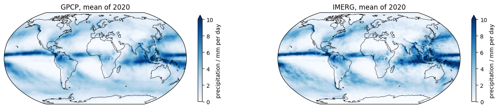
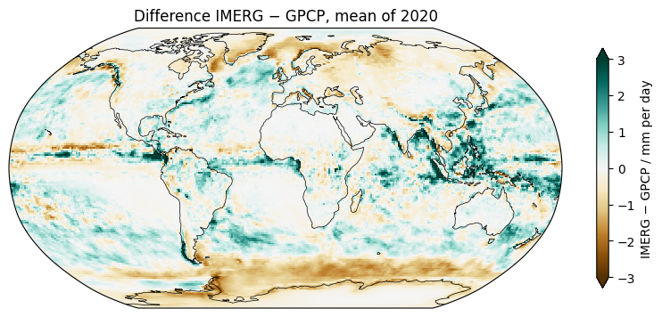
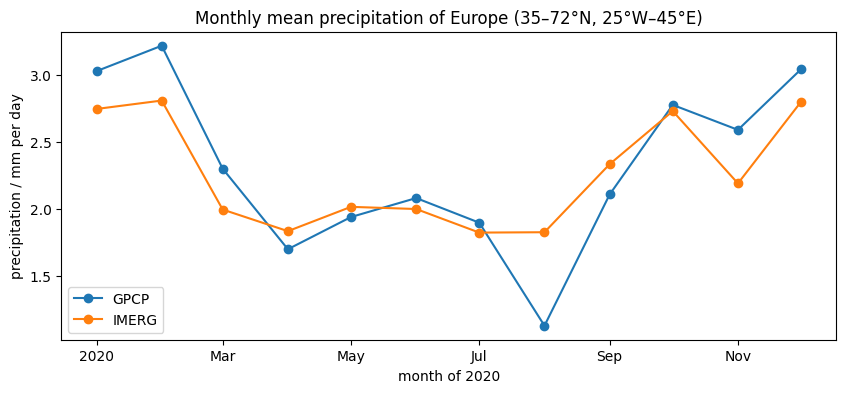

# 04 · Comparing datasets

Python for Climate Science · TUHH

<small>MPI-M · class page: *Classes → 04* · notebooks `class04_get_frogs_data` and `class04_compare_datasets`</small>

---

## Today

1. How much does it rain? **Three ways** to estimate it
2. **FROGS**: many products on the same grid
3. **Maps** with the same colours, and their **difference**
4. Why a global mean can **hide** large differences
5. Two **curves** for Europe

---

## Three ways to estimate precipitation

| Way | Strong | Weak |
|---|---|---|
| **Rain gauges** (class 02) | direct measurement | few over the ocean |
| **Satellites** | everywhere, every day | indirect |
| **Reanalysis** (class 07) | complete in space and time | depends on the model |

Different methods → different estimates → **uncertainty**

---

## Part 1 · FROGS

- More than 50 precipitation products (Roca et al., 2019)
- All on the **same grid**: 1° × 1°, one value per day
- One folder per product, **one file per year** (~95 MB)

| Product | What |
|---|---|
| `GPCP_CDR_v1.3_yes_enforced` | satellites + rain gauges |
| `IMERG_V07B_FC` | satellites, calibrated with gauges |

Note: Open the catalog with the students: thredds-x.ipsl.fr/thredds/catalog/FROGs/catalog.html

---

## Part 1 · Download

```python
from utils import download_frogs

gpcp_file = download_frogs("GPCP_CDR_v1.3_yes_enforced", 2020)
imerg_file = download_frogs("IMERG_V07B_FC", 2020)
```

- The list of files of a product: its `catalog.xml`
- The year is the **last number** in the file name
- The download: `download_file`, from class 03

---

## Part 1 · The same grid

```python
gpcp = xr.open_dataset(gpcp_file)["rain"]     # mm/day
imerg = xr.open_dataset(imerg_file)["rain"]

(gpcp.lat == imerg.lat).all()                 # True
(gpcp.lon == imerg.lon).all()                 # True
```

Same grid → you can **subtract** them directly

---

## Part 2 · Maps with the same colours



`vmin=0, vmax=10` for both: the same colour means the same value

---

## Part 2 · The difference

```python
difference = imerg.mean("time") - gpcp.mean("time")
difference.plot(cmap="BrBG", vmin=-3, vmax=3)
```

--



<small>Green: IMERG wetter · brown: GPCP wetter</small>

---

## Part 2 · What a global mean hides

| | 2020, global mean |
|---|---:|
| GPCP | 2.66 mm/day |
| IMERG | 2.73 mm/day |

Close! But by latitude:

| Band | IMERG − GPCP |
|---|---:|
| 60°S–90°S | −0.68 mm/day |
| 10°S–10°N | +0.39 mm/day |
| 60°N–90°N | −0.40 mm/day |

Positive and negative differences **cancel**

---

## Part 2 · Two curves for Europe



<small>Close in most months; August 2020: 1.1 (GPCP) against 1.8 mm/day (IMERG)</small>

---

## Exercise: a third product

1. Download 2020 of a third product, e.g. `ERA5` (a reanalysis)
2. Its difference to GPCP
3. The **spread** of three products:

```python
products = xr.concat([gpcp_year, imerg_year, third_year],
                     dim="product")
spread = products.std("product")
```

4. Europe with **three curves**

---

## Your page

1. Open `pages/04_comparing_datasets/my_page.rst` in JupyterLab
2. The notebook already put your plots next to it
3. Write your name: where do the products agree, where not?
4. Check it on http://localhost:8000 → *Classes → 04*
5. Print → **Save as PDF** → send it to the tutor

<small>Data: FROGS (Roca et al., 2019)</small>

---

## For next class

- Finish the exercise and your page
- Next: **05 · Getting to know HEALPix** (simulation output on a new kind of grid)

---

# Questions?
