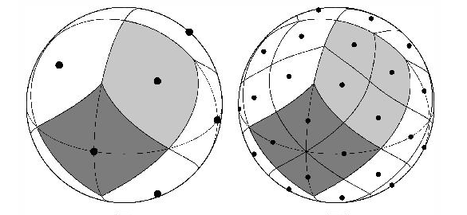
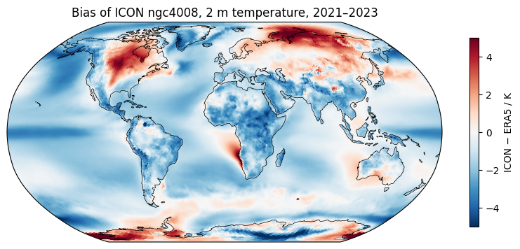
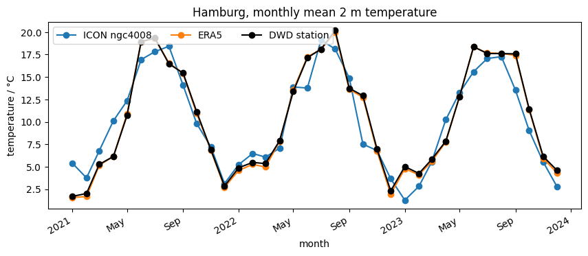

# 05 · Getting to know HEALPix

Python for Climate Science · TUHH

<small>MPI-M · class page: *Classes → 05* · notebooks `class05_get_healpix_data` and `class05_evaluate_models`</small>

---

## Today

1. From observations to a **climate model**
2. The **HEALPix** grid
3. An **intake catalog**: the nextGEMS simulations
4. **Evaluating** a model: its **bias** compared with ERA5
5. Maps, the global mean, and one place

---

## Models and their bias

- A **climate model** simulates the climate on a computer
- To know how good it is, compare it with observations (here: ERA5)
- **Bias** = model − observation
  - positive: too warm · negative: too cold

**nextGEMS**: a European project with global simulations at kilometre scale, models **ICON** and **IFS**

---

## Part 1 · The HEALPix grid



- 12 cells of **equal area**, each split into 4 at every **zoom** level
- $12 \cdot 4^z$ cells, $\mathrm{nside} = 2^z$

---

## Part 1 · Zoom levels

| zoom | cells | spacing |
|---:|---:|---:|
| 6 | 49 152 | ~100 km |
| 7 | 196 608 | ~50 km |
| 10 | 12 582 912 | ~6 km |

- We use **zoom 6**: 4 times less data than zoom 7
- Equal areas → global mean = plain `.mean("cell")`, **no weights**
- Cells have **numbers**, not latitudes and longitudes

Note: Class 06 is about the zoom levels; here only enough to read the data.

---

## Part 1 · The catalog

```python
import intake

cat = intake.open_catalog(
    "https://data.nextgems-h2020.eu/online.yaml")
list(cat)        # ICON, IFS, ERA5, ...
list(cat.ICON)   # ngc3028, ngc4008, d3hp003

icon = cat.ICON.ngc4008(zoom=6, time="P1D").to_dask()
icon["tas"]      # 2 m temperature, K
```

<small>The IFS simulation is not accessible at the moment: this class uses ICON</small>

---

## Part 1 · Monthly means, saved

```python
icon_file = pathlib.Path(
    "data/icon_ngc4008_tas_monthly_2021-2023_zoom6.nc")

if not icon_file.exists():
    tas = icon["tas"].sel(time=slice("2021-01-01",
                                     "2023-12-31"))
    tas.resample(time="MS").mean().to_netcdf(icon_file)
```

Reads ~200 MB, a few minutes: **once**, then from `data/`

---

## Part 2 · A HEALPix map

```python
import easygems.healpix as egh

ax = plt.axes(projection=ccrs.Robinson())
ax.set_global()
ax.coastlines()
egh.healpix_show(bias, ax=ax, cmap="RdBu_r",
                 vmin=-5, vmax=5)
```

Same grid → `bias = icon_mean - era5_mean`

---

## Part 2 · The bias of ICON



<small>ngc4008 − ERA5, 2021–2023: −1.07 K globally; about −1.5 K in the tropics; too warm over parts of North America and Siberia</small>

---

## Part 2 · Global mean and one place

```python
icon.mean("cell")                     # equal areas

nside = hp.npix2nside(icon.sizes["cell"])   # 64
hamburg = hp.ang2pix(nside, 10.0, 53.55,
                     nest=True, lonlat=True)
icon.isel(cell=hamburg)               # a time series
```

--



<small>ERA5 follows the real weather; the model makes its own: compare means over many months, not single months</small>

---

## Exercise: a second simulation

**ngc3028**, also ICON:

1. Its monthly means of 2021–2023, saved (part 1)
2. Its bias map
3. The global mean: three curves
4. Which simulation is closer to ERA5? Globally? In the north?

---

## Your page

1. Open `pages/05_healpix/my_page.rst` in JupyterLab
2. The notebook already put your plots next to it
3. Write your name and describe the biases
4. Check it on http://localhost:8000 → *Classes → 05*
5. Print → **Save as PDF** → send it to the tutor

---

## For next class

- Finish the exercise and your page
- Next: **06 · Working with zoom levels**

---

# Questions?
