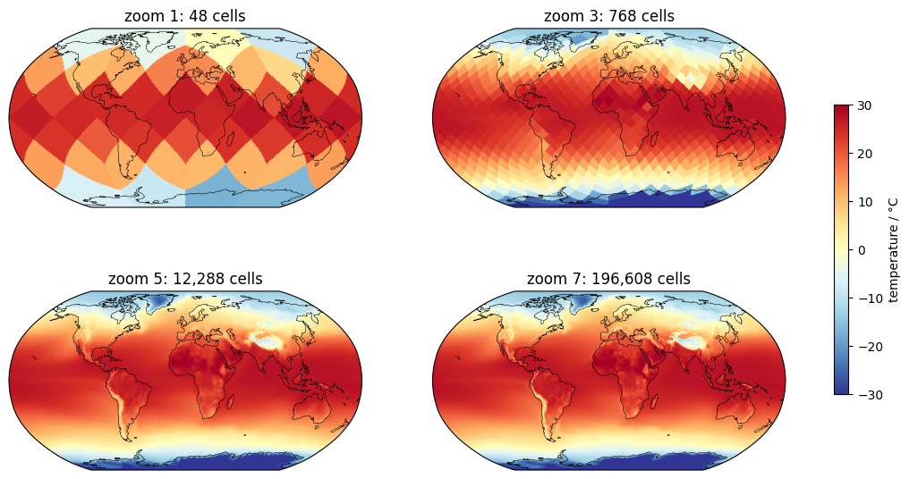
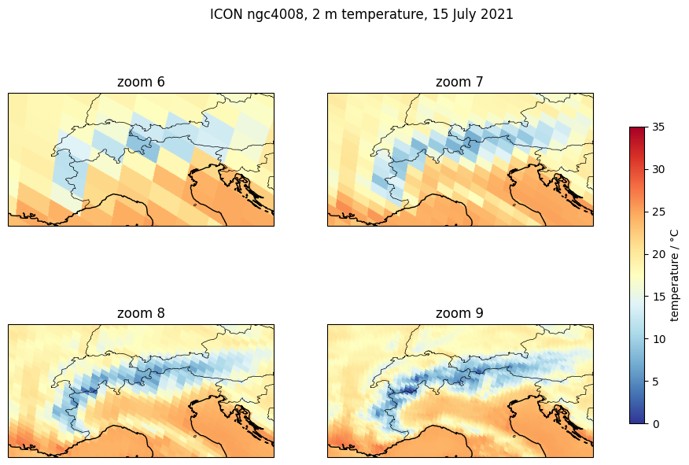
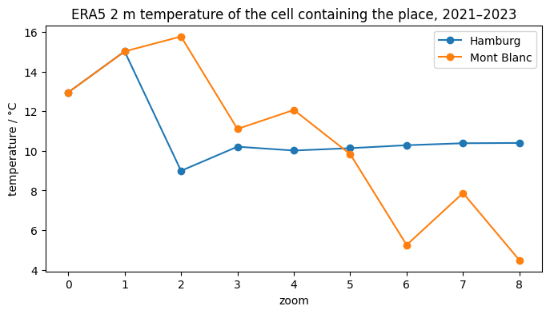

# 06 · Working with zoom levels

Python for Climate Science · TUHH

<small>MPI-M · class page: *Classes → 06* · notebook `class06_zoom_levels`</small>

---

## Today

1. What a **zoom level** costs: cells, spacing, data
2. The same map at **different zooms**: the globe and the Alps
3. The **global mean** does not change with the zoom
4. **One place** does
5. How to **choose** a zoom

---

## Zoom levels

| zoom | cells | spacing | one map |
|---:|---:|---:|---:|
| 5 | 12 288 | ~200 km | 0.05 MB |
| 6 | 49 152 | ~100 km | 0.2 MB |
| 8 | 786 432 | ~25 km | 3 MB |
| 9 | 3 145 728 | ~13 km | 13 MB |
| 10 | 12 582 912 | ~6 km | 50 MB |

Every zoom level: spacing **÷ 2**, data **× 4**

---

## The globe at four zooms



<small>ERA5, mean of 2021–2023 · zoom 1 shows the shape of the cells · from zoom 5 on the globe looks smooth</small>

---

## The Alps at four zooms



<small>ICON ngc4008, 15 July 2021 · zoom 9 (~13 km) shows valleys and ridges</small>

Note: The ICON data at zoom 10 has no values of the 2 m temperature, so zoom 9 is the finest here.

---

## A region

```python
ax = plt.axes(projection=ccrs.PlateCarree())
ax.set_extent([4, 16, 43, 49],          # W, E, S, N
              crs=ccrs.PlateCarree())
ax.add_feature(cfeature.BORDERS)

day = cat.ICON.ngc4008(zoom=9, time="P1D").to_dask()
egh.healpix_show(day["tas"].sel(time="2021-07-15")
                 .squeeze(), ax=ax)
```

---

## The global mean does not change

ERA5, 2021–2023: **14.76 °C at every zoom from 0 to 8**

A cell = the **mean of its 4 cells** of the next zoom, numbered one after the other (**nested**):

```python
made_zoom6 = zoom7.reshape(-1, 4).mean(axis=1)
# = the zoom 6 of the catalog (< 0.001 °C)
```

---

## One place does change



<small>Hamburg: ~10 °C from zoom 3 on · Mont Blanc: 11 °C (zoom 3) → 4.5 °C (zoom 8): a cell is an area, not a point</small>

---

## Choosing a zoom

| You want | Zoom |
|---|---|
| a global mean, a large region | any: the mean does not change |
| a map of the globe | 5–6 |
| a country, a mountain range | 8–9 |
| one place in the mountains | as fine as the data has |

**The coarsest zoom that shows what you need**

---

## Exercise: your region

1. Your region (class 01) at **four zooms**
2. One place of it at **zoom 0 to 8**
3. Which zoom do you need?

Saved next to your page: `region_exercise.png`, `point_exercise.png`

---

## Your page

1. Open `pages/06_zoom_levels/my_page.rst` in JupyterLab
2. The notebook already put your plots next to it
3. Write your name: what does the zoom change, what not?
4. Check it on http://localhost:8000 → *Classes → 06*
5. Print → **Save as PDF** → send it to the tutor

---

## For next class

- Finish the exercise and your page
- Next: **07 · Machine learning for climate data**

---

# Questions?
