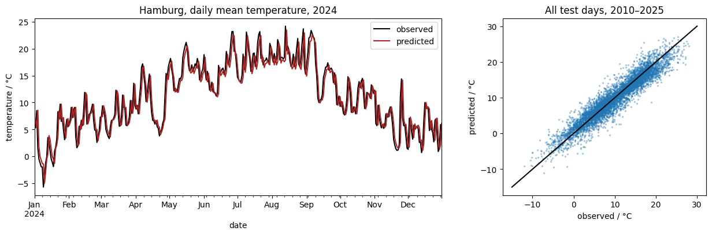
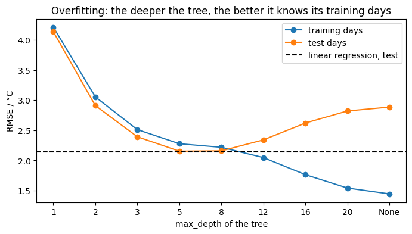
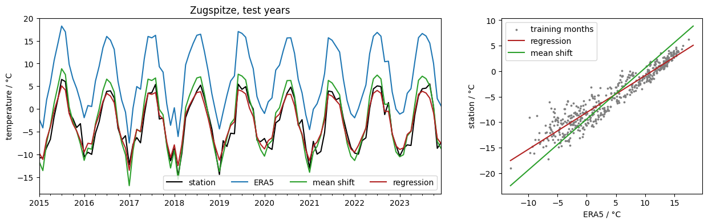
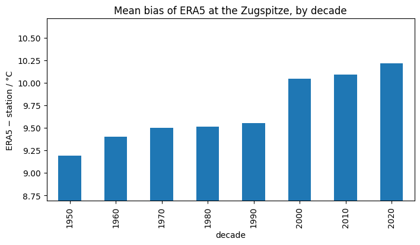

# 07 · Machine learning for climate data

Python for Climate Science · TUHH

<small>MPI-M · class page: *Classes → 07* · notebooks `class07_ml_regression` and `class07_ml_bias_correction`</small>

Note: About 2 hours: introduction 15 min, part 1 about 50 min, part 2 about 50 min, grids to samples and discussion 10 min.

---

## Today

1. What is **machine learning**?
2. A first model: predict **tomorrow's temperature** in Hamburg
3. Evaluate it honestly: **testing**, simple guesses, **overfitting**
4. Correct the **bias of ERA5** at a mountain station
5. From grids to samples, and the limits

---

## Machine learning in a nutshell

**Supervised learning**: learn a rule from examples where the answer is known

| Word | Meaning |
|---|---|
| **features** (X) | what the model sees |
| **target** (y) | what it should predict |
| **regression** | the target is a number (a temperature) |
| **classification** | the target is a class (heavy rain or not) |
| **training / testing** | learn on some examples, check on others |

Note: Unsupervised learning (finding groups without known answers) is only mentioned, not used.

---

## scikit-learn: always two steps

```python
from sklearn.linear_model import LinearRegression

model = LinearRegression()
model.fit(X_train, y_train)          # learn
prediction = model.predict(X_test)   # use
```

The same for every model of `scikit-learn`

---

## Part 1 · Features from the past

```python
data = pd.DataFrame({"today": hamburg["TMK"]})
data["yesterday"] = data["today"].shift(1)
data["two_days_ago"] = data["today"].shift(2)
data = data.dropna()

X = data[["yesterday", "two_days_ago"]]
y = data["today"]
```

Station Hamburg-Fuhlsbüttel (class 02), daily, 1936–2025

---

## Part 1 · Split in time order

- Training **1936–2009**, testing **2010–2025**
- A forecast only knows the **past**
- The climate changes: the test years are **1.3 °C warmer** (10.17 against 8.88 °C)

A random split would mix the periods and could not tell whether the model works in a warmer climate

---

## Part 1 · How good?

| Prediction of the test days | RMSE |
|---|---:|
| linear regression | **2.14 °C** |
| persistence: tomorrow = today | 2.17 °C |
| climatology: always the mean | 6.88 °C |

Barely better than persistence: **always compare with a simple guess**

Note: The coefficients are 0.965 for yesterday and −0.02 for two days ago: tomorrow is mostly like today.

---

## Part 1 · Observed and predicted



---

## Part 1 · Overfitting



<small>A deep tree learns its training days by heart: 1.44 °C on the training days, 2.89 °C on the test days</small>

---

## Part 1 · Information from the future

```python
data["tomorrow"] = data["today"].shift(-1)   # a mistake!
```

RMSE **1.46 °C**: better, and useless. If a result looks too good, look for **leakage**

Note: A common student mistake is to confuse shift(1) and shift(-1).

---

## Part 2 · A bias correction

- ERA5 gives the mean of a **cell** (~25 km at zoom 8); a station measures a **point**
- **Zugspitze**, 2 956 m: ERA5 is about **10 °C too warm** (class 06: a cell is an area)
- Feature: ERA5 of the cell · target: the station · monthly, 1950–2023
- Train on **1950–1990**, test on **1991–2023**

---

## Part 2 · Two corrections

```python
shift = (y[train] - X["era5"][train]).mean()     # mean shift
model = LinearRegression().fit(X[train], y[train])
```

| Test years | Mean bias | RMSE |
|---|---:|---:|
| ERA5 | +9.95 °C | 10.22 °C |
| mean shift | +0.55 °C | 2.39 °C |
| regression: 0.722 × ERA5 − 8.10 | **+0.14 °C** | **1.61 °C** |

---

## Part 2 · Corrected



<small>The slope 0.72 < 1: ERA5 swings more between winter and summer than the summit</small>

---

## Part 2 · Does the bias stay?



From about 9.2 °C (1950s) to 10.2 °C (2020s): **what worked in the past may not hold in a changing climate**

---

## From grids to samples

- `(time, cell)` → a table of **samples** (rows) and **features** (columns), or one model per cell
- Lon-lat or HEALPix: the algorithm does not care
- Features and targets must refer to the **same times and places**

**Why not ICON?** It makes its own weather (class 05): its January 2015 is not the real one, so month-by-month pairs mean nothing. Free-running models are corrected by their **statistics**.

---

## Limits

- Simple models, one station: an introduction, not an operational forecast
- Test on **independent** data, in time order
- A good fit in the past is no guarantee in a **changing climate**

---

## Your page

1. Open `pages/07_machine_learning/my_page.rst` in JupyterLab
2. The notebooks already put your plots next to it
3. Write your name and describe your results
4. Check it on http://localhost:8000 → *Classes → 07*
5. Print → **Save as PDF** → send it to the tutor

---

# Thank you! Questions?
