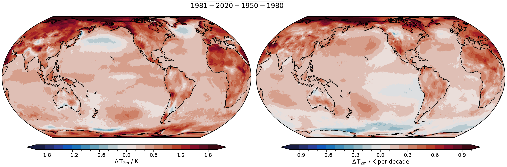
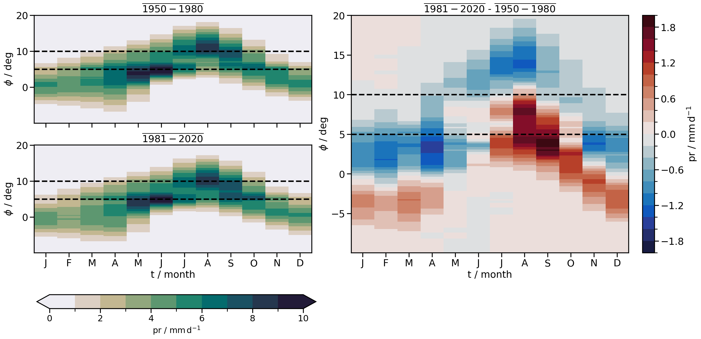
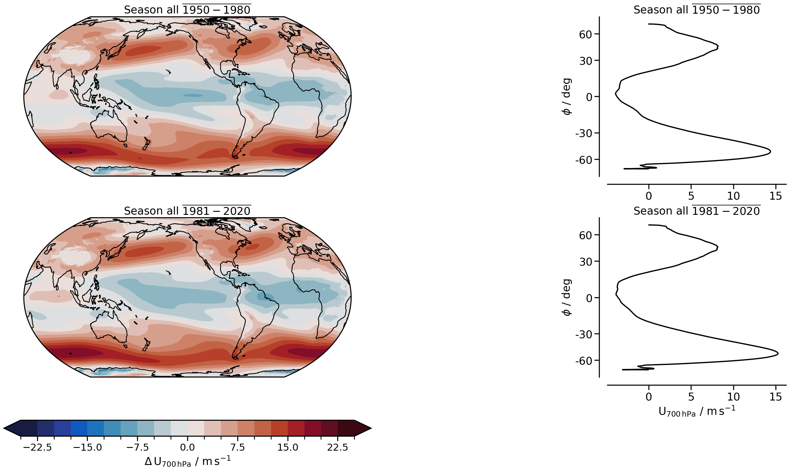

# Extra 02 · Climate analysis with xarray

Python for Climate Science · TUHH

<small>MPI-M · notebook `examples/extra_02_more_xarray_climate.ipynb`</small>

---

## Today

1. **Anomalies** and the seasonal cycle
2. **Trends** in every cell
3. **Hovmöller** diagram of the West African monsoon
4. The **eddy-driven jet**
5. **Correlations**

Two periods: historical 1950–1980 and recent 1981–2020.

---

## Anomalies

Remove the seasonal cycle of the reference period, month by month:

```python
f_anomalies = lambda da, da_ref: (
    da.groupby("time.month") - da_ref.groupby("time.month").mean("time")
)
```

---

## Trends in every cell

```python
def get_2d_tendencies(ds):
    years_ = [pd.Timestamp(x).year for x in ds.time.values]
    f_get_tendency = lambda data: np.polyfit(years_, data, 1)[0]
    return xr.apply_ufunc(f_get_tendency, ds, input_core_dims=[["time"]],
                          vectorize=True, dask="parallelized", output_dtypes=["f4"])
```

`apply_ufunc` runs a NumPy function on every cell, lazily with Dask.

---

## Warming since 1950



<small>Left: 1981–2020 minus 1950–1980. Right: trend in K per decade.</small>

---

## Hovmöller diagram

Monthly rainfall averaged over 10° W–10° E, latitude against month.



<small>Dashed: 5° N (Guinean coast) and 10° N (monsoon onset in the Sahel).</small>

---

## The eddy-driven jet

Zonal-mean 700 hPa zonal wind $u(\phi)$. Jet latitude as a weighted mean (Adam et al. 2018), with $n = 8$:

$$\phi_\mathrm{jet} = \frac{\sum u^n \phi}{\sum u^n}$$

Jet strength: $u$ at $\phi_\mathrm{jet}$ from a cubic spline.

--



---

## Correlations

```python
df_anomalies_yearly = df_anomalies_monthly.resample("Y").mean()
df_anomalies_yearly.corr(method="pearson")
```

Correlation is not causation: two series with a trend correlate.

---

## Try it

- Change `season` to `"DJF"`, `"MAM"`, `"JJA"` or `"SON"` in the jet plot
- Switch `var, region` between `u_max`/`u_lat` and `NH`/`SH`
- Add precipitation trends next to the temperature trends

<small>Then add your lessons learned to the webpage.</small>

---

# Questions?
