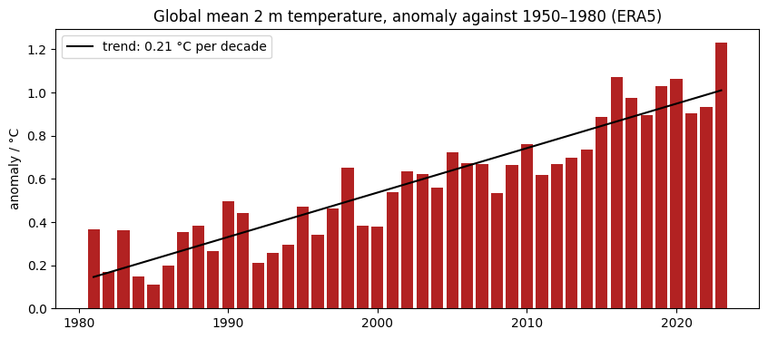
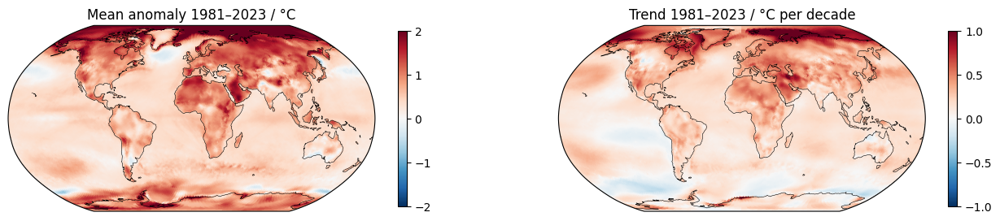

# Extra · Anomalies and the seasonal cycle

Python for Climate Science · TUHH

<small>MPI-M · page: *Extras → Anomalies* · notebook `extra_anomalies_seasonal_cycle`</small>

---

## Seasonal cycle and anomalies

- **Seasonal cycle**: the mean of every month
- **Anomaly**: a value minus the mean of its month in a reference period

```python
climatology = reference.groupby("time.month").mean()
anomalies = recent.groupby("time.month") - climatology
```

Reference 1950–1980 · recent 1981–2023 · ERA5 2 m temperature

---

## Global mean: 0.21 °C per decade



```python
slope, intercept = np.polyfit(years, yearly.values, 1)
```

---

## Where it warms



<small>`np.polyfit(years, table, 1)`: one line per column, i.e. per cell, at once · most over land and in the Arctic</small>

---

## Exercise

The seasonal cycle, the anomalies and the trend of **one place** (the cell of Hamburg, or of your region):

- Larger or smaller trend than the globe?
- Why are its anomalies more irregular?

---

# Questions?
