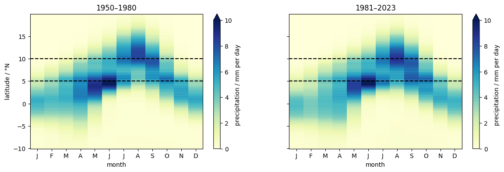
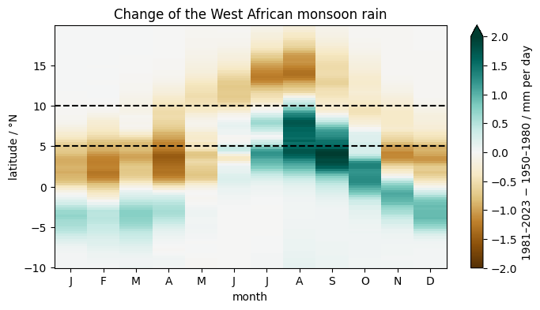

# Extra · A Hovmöller diagram

Python for Climate Science · TUHH

<small>MPI-M · page: *Extras → Hovmöller diagram* · notebook `extra_hovmuller_diagram`</small>

---

## Position against time

- A **Hovmöller diagram**: latitude against month, in one picture
- The rain band of the **West African monsoon**, 10°W–10°E, 10°S–20°N
- ERA5 precipitation at zoom 7, m per day × 1000 → mm per day

---

## Two means

```python
precipitation = era5["tp"].isel(cell=cells).compute()

hovmoller = 1000 * (precipitation
    .groupby("time.month").mean()   # each month, over the years
    .groupby("lat").mean())         # each ring of equal latitude
```

HEALPix cells lie on **rings of equal latitude**

---

## The monsoon



<small>At the coast (5°N) in May–June · at 10°N and further north in August · back south in autumn</small>

---

## Has it changed?



---

## Exercise

The **Indian monsoon**: 70–90°E, 10°S–30°N. When does the rain arrive at 20°N?

---

# Questions?
