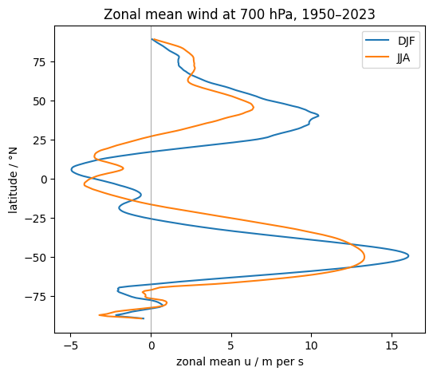
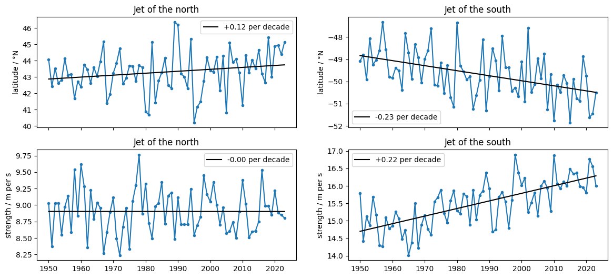

# Extra · The jet stream

Python for Climate Science · TUHH

<small>MPI-M · page: *Extras → The jet stream* · notebook `extra_jet_stream`</small>

---

## The eddy-driven jet

- A band of strong **westerly** wind in the mid-latitudes; it steers the storms
- ERA5 zonal wind `u` at **700 hPa**, zoom 6, 1950–2023

```python
u = era5["u"].sel(level=700, time=slice("1950", "2023"))
winter = u.sel(time=u.time.dt.month.isin([12, 1, 2]))
zonal = u.groupby("lat").mean()     # rings of equal latitude
```

---

## The zonal mean



<small>Two jets, near 45°N and 50°S · the southern one stronger · both towards the pole in their summer</small>

---

## Latitude and strength

```python
weights = band.clip(min=0) ** 8        # only westerly wind
latitude = ((weights * band.lat).sum("lat")
            / weights.sum("lat"))
strength = band.max("lat")
```

Adam et al. (2018): the strongest winds count almost alone

---

## Since 1950



<small>Southern jet: 0.8° towards the pole and 0.8 m/s stronger (1981–2023 vs 1950–1980) · northern jet: little change</small>

---

## Exercise

The **subtropical jet** at 250 hPa: its zonal mean in DJF and JJA, its latitude and strength. Closer to the equator?

---

# Questions?
