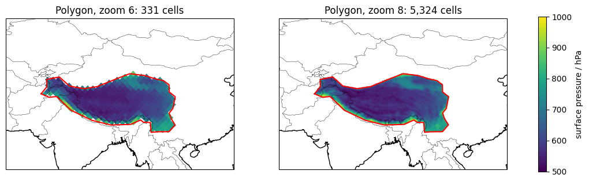
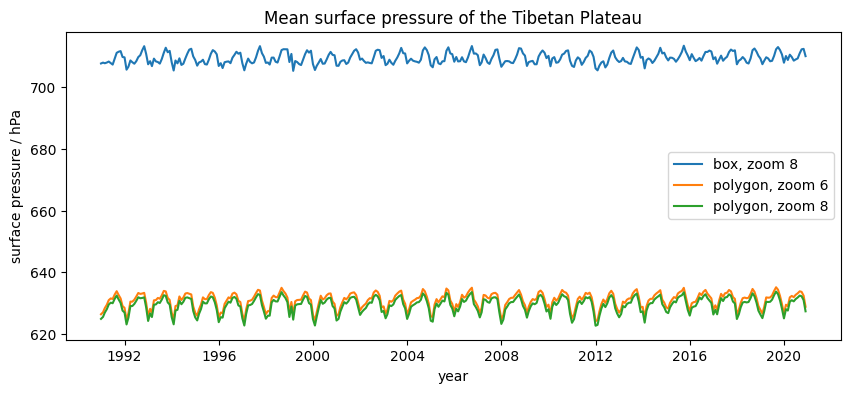

# Extra · Regional analysis

Python for Climate Science · TUHH

<small>MPI-M · page: *Extras → Regional analysis* · notebook `extra_regional_analysis`</small>

---

## The cells of a region

```python
lon = (ds["lon"].values + 180) % 360 - 180   # -180 to 180
lat = ds["lat"].values

inside = ((lon > 73) & (lon < 105)
          & (lat > 26) & (lat < 40))         # a box
cells = np.where(inside)[0]

ds["sp"].isel(cell=cells).mean("cell")      # regional mean
```

Equal areas: a plain mean, as for the globe

---

## A polygon

```python
from shapely.geometry import Polygon
import geopandas as gpd

tibet = Polygon([(69.30, 35.05), (71.45, 34.12), ...])
points = gpd.GeoSeries(gpd.points_from_xy(lon, lat))
cells = np.where(points.within(tibet))[0]
```

--



---

## Shape or zoom?

| | zoom 6 | zoom 8 |
|---|---:|---:|
| Box | 437 cells | 7 098 cells |
| Polygon | 331 cells | 5 324 cells |

- Box − polygon: **+80 hPa** (the box contains the lowlands)
- Polygon at zoom 6 − zoom 8: **+1.4 hPa**

**The shape of the region matters much more than the zoom**

---



---

## Exercise

1. **Costa Rica** (86–82.5°W, 8–11.5°N): how many cells at zoom 6 and 8?
2. A region of your choice: its cells, a map, and its mean **2 m temperature**

---

# Questions?
